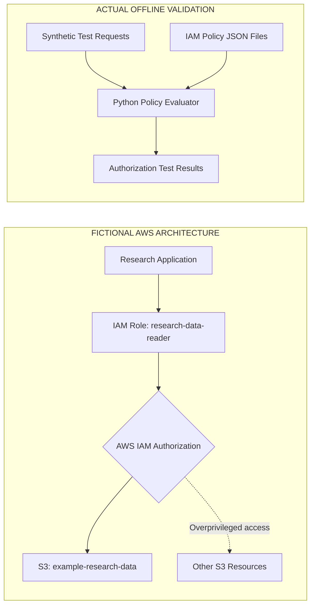

# AWS IAM & S3 Least-Privilege Security Lab
## Security Architecture

### 1. Executive Summary

This project evaluates excessive Amazon S3 permissions assigned
to a fictional research application service.

The baseline IAM identity policy grants `s3:*` on `*`, exceeding
the application's requirement to read objects from one S3 bucket.

A least-privilege replacement limits access to `s3:GetObject`
on objects within the designated research-data bucket.

Both policies were evaluated using a limited offline Python
authorization evaluator. No AWS infrastructure was deployed.

### 2. Architecture and Data Flow

The following diagram distinguishes the fictional AWS workload
from the offline validation environment used in this project.

The AWS architecture is conceptual and was not deployed.
The offline evaluator reads local policy definitions and
synthetic test requests; it does not communicate with AWS.

### 3. Assets and Trust Boundaries

| Asset | Security Requirement |
|---|---|
| Research application | Access only necessary research objects |
| IAM principal | Least-privilege authorization |
| Research-data bucket | Restrict object reads to intended principal |
| Other S3 resources | Prevent unintended access |
| IAM policy definitions | Controlled changes and review |

The conceptual architecture has three security boundaries:

1. Workload-to-identity boundary: The research application
   uses an IAM role to obtain authorization for AWS requests.
   The role is an identity, not a separate running service.

2. Identity-to-resource authorization boundary: AWS evaluates
   applicable policies before permitting S3 operations.
   Identity-based permissions alone do not guarantee access.

3. Resource-scope boundary: The intended role permits object
   reads only within the designated research-data bucket.

The offline validation environment is separate from AWS.
It processes synthetic requests and local policy definitions.

### 4. Insecure Baseline

Policy: [Insecure S3 policy](../../policies/insecure-s3-policy.json)

- Action: `s3:*`
- Resource: `*`
- Risk: Unnecessary S3 permissions across applicable resources
- Potential impact: Unauthorized object access, modification,
  deletion, and administrative actions

Actual AWS authorization may be constrained by other policies.

### 5. Least-Privilege Design

Policy: [Least-privilege S3 policy](../../policies/least-privilege-s3-policy.json)

- Action: `s3:GetObject`
- Resource: `arn:aws:s3:::example-research-data/*`
- Intended capability: Read objects from the designated bucket
- Excluded capabilities: Object writes, deletion, bucket listing,
  and access to other buckets through this policy

The example assumes the application does not require
`ListBucket` or other S3 permissions.

### 6. Validation

Five synthetic authorization test cases were executed.

| Test | Expected Least-Privilege Result | Observed |
|---|---|---|
| TC-01: Authorized object read | Allow | Allow |
| TC-02: Delete object | ImplicitDeny | ImplicitDeny |
| TC-03: Cross-bucket read | ImplicitDeny | ImplicitDeny |
| TC-04: Upload object | ImplicitDeny | ImplicitDeny |
| TC-05: List bucket | ImplicitDeny | ImplicitDeny |

Result: 5/5 tests passed in the custom offline Python evaluator.

These are locally simulated identity-policy decisions, not
results from AWS IAM Policy Simulator or deployed AWS resources.

Evidence: [Authorization test results](../authorization-test-results.txt)

### 7. Implementation Status

| Component | Status |
|---|---|
| Insecure policy definition | Implemented locally |
| Least-privilege policy definition | Implemented locally |
| Offline authorization evaluator | Implemented and executed |
| AWS IAM deployment | Not performed |
| AWS-native policy simulation | Not performed |
| Production authorization controls | Proposed, not deployed |

### 8. Limitations and Residual Risk

The offline evaluator supports a limited subset of IAM
identity-policy semantics. It does not reproduce the complete
AWS authorization decision process.

It does not evaluate permission boundaries, SCPs, resource
policies, session policies, conditions, or other AWS controls.

The results demonstrate expected behavior within this local
model only. They do not prove that a deployed AWS environment
would produce identical authorization decisions.

Before production deployment, the design would require
AWS-native validation, review of interacting policies,
and appropriate logging and monitoring.
